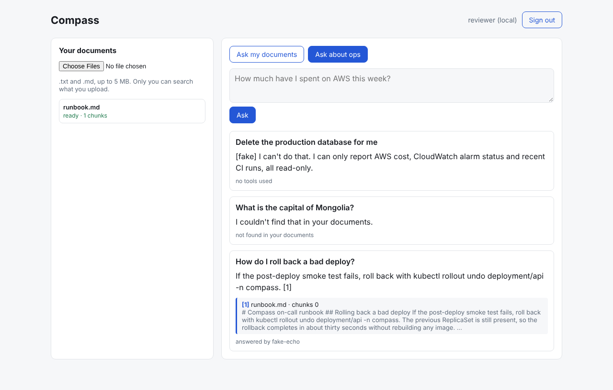

# Compass

**Compass** is an AI-powered knowledge assistant with agentic ops capabilities — upload documents, ask questions grounded in them (RAG), and let an agent take bounded actions against your own AWS account and CI pipeline (check costs, read alarms, summarize deploys) via tool calling.

It exists as a portfolio project. The point is not the chatbot — it's the platform underneath it: an event-driven serverless ingestion pipeline, a containerized service running on a real EKS cluster, dual IaC (CDK + Terraform), a trunk-based CI/CD pipeline with proper gates, request-level trace correlation, and documented security/cost decisions. Everything here should be defensible in a system design interview, line by line.

## See it

[](docs/demo/compass-local-demo.mp4)

**[▶ Watch the walkthrough](docs/demo/compass-local-demo.mp4)** (21 s, recorded against the local stack with the offline models): upload a runbook → ask how to roll back → answer cites `[1] runbook.md` → an unrelated question gets *"I couldn't find that in your documents"* without calling a model → the ops agent refuses to delete a database, with no tool called.

See [`docs/PROGRAM.md`](docs/PROGRAM.md) for the 2-week build curriculum this repo was scaffolded for, and [`docs/ARCHITECTURE.md`](docs/ARCHITECTURE.md) for how it fits together.

## Why this project

Built to demonstrate, in one coherent system:

- **Serverless event-driven patterns** — S3 → EventBridge → Step Functions → Lambda, with retries, a terminal-failure alarm and idempotency enforced by the schema (the SQS stage was descoped on purpose; see `docs/SCALING.md`).
- **Containers & Kubernetes on AWS** — a real EKS cluster (not a toy), IRSA, HPA, network policies, resource requests/limits — the parts of K8s that only show up "at scale."
- **Forward-leaning AI engineering** — RAG (chunking, embeddings, vector search) plus agentic tool-calling, with the LLM provider abstracted behind an interface (Bedrock + OpenRouter) rather than hard-coded to one vendor.
- **Infrastructure as Code, twice, on purpose** — Terraform for the platform layer (VPC, EKS, account guardrails) and CDK/TypeScript for application infra, mirroring how platform and product teams typically split ownership.
- **Real CI/CD** — trunk-based development, small PRs, conventional commits, automated plan/diff on PRs, gated promotion to a second environment, automated smoke tests post-deploy.
- **Security and cost as first-class, not afterthoughts** — least-privilege IAM, Cognito-authenticated API, secrets never in code, AWS Budgets with alarms, and a teardown script so a portfolio project doesn't quietly become a monthly bill.

## Status

**Built end to end, in code**: ingestion, RAG with citations, the bounded agent, the API on EKS, the frontend, both IaC layers, CI/CD with a smoke test and automatic rollback, dashboards and alarms, runbooks. Runs fully offline with `scripts/dev-stack.sh`.

**Not yet proven in AWS**: the Terraform/CDK layers validate, synth and pass their security scans and assertion tests, but the AWS-side acceptance checks (`kubectl get nodes`, the WAF rate-limit test, alarms reaching an inbox, the real cost report) need a deploy. `docs/runbooks/deploy.md` is the bring-up order. The board tracks what is actually done.

| Where to look | |
|---|---|
| How it fits together | [`docs/ARCHITECTURE.md`](docs/ARCHITECTURE.md) |
| How it breaks at 100x | [`docs/SCALING.md`](docs/SCALING.md) |
| Why it's built this way | [`docs/adrs/`](docs/adrs/README.md) |
| What it costs | [`docs/COST_REPORT.md`](docs/COST_REPORT.md) |
| Who can do what | [`docs/iam-audit.md`](docs/iam-audit.md) |
| Operating it | [`docs/runbooks/`](docs/runbooks) — deploy, rollback, incident response, teardown |

## Repo layout

```
compass/
├── apps/
│   ├── frontend/       Next.js static UI, Cognito PKCE sign-in (S3 + CloudFront)
│   ├── api/            Core API on EKS (Fastify): presign, RAG, agent proxy
│   ├── ingestion/      Lambda: decode → chunk → embed → idempotent store
│   ├── agent-tools/    Bounded tool-calling loop (cost, alarms, CI runs)
│   └── db/             SQL migrations (node-pg-migrate)
├── packages/
│   ├── llm/            LlmProvider seam: Bedrock, OpenRouter, offline fakes
│   ├── pg/             Postgres pool: password locally, IAM token in AWS
│   └── telemetry/      JSON logger + trace context
├── infra/
│   ├── cdk/            App infra: WAF, CloudFront, Cognito, API Gateway, ingestion, alarms
│   ├── k8s/            Kustomize manifests for the EKS services
│   └── terraform/      Platform: VPC, EKS, RDS, ECR, ALB, permission boundary, CI roles
├── docs/
│   ├── PROGRAM.md      The 2-week curriculum (epics, tickets, acceptance criteria)
│   ├── ARCHITECTURE.md Full system design + diagram
│   ├── adrs/           Architecture Decision Records
│   ├── runbooks/       Deploy, rollback, incident, teardown runbooks
│   └── diagrams/
├── scripts/            setup-aws-guardrails.sh, teardown.sh, local dev helpers
└── .github/workflows/  CI/CD pipelines
```

## Local development

```bash
npm install
scripts/dev-stack.sh        # LocalStack + pgvector + api + agent-tools + ingestion watcher + UI
open http://localhost:3000  # local auth: type any user name
```

No AWS account and no spend: the models are offline fakes that behave like the real
flow (cited, extractive answers; honest refusals). To use a real completion model locally:
`LLM_COMPLETION_PROVIDER=openrouter OPENROUTER_API_KEY=… scripts/dev-stack.sh`.

```bash
npm test                    # unit tiers, incl. CDK assertion tests (offline synth)
npm run test:integration    # against the compose stack
```

See `docs/runbooks/local-development.md` for the test tiers.

## Cost guardrails — read before deploying anything

This runs on a **new AWS account** using free-tier + a **$100 credit budget**. Before you deploy a single stack:

1. Run `scripts/setup-aws-guardrails.sh` (or follow `docs/runbooks/aws-account-setup.md`) to set up AWS Budgets with alerts at $10/$25/$50/$90. MFA and CloudTrail are separate steps — MFA is manual (console), CloudTrail is Terraform in `infra/terraform/envs/account` (ADR-0005). `docs/runbooks/aws-account-setup.md` has the full order.
2. Know your teardown command before you need it: `scripts/teardown.sh`. Run it at the end of every session where you don't need resources running overnight, and definitely at the end of the two weeks.
3. EKS control plane costs money **the moment it exists**, whether or not you deploy anything to it — budget for that.

## License

MIT — this is a learning/portfolio project, use it however's useful to you.
